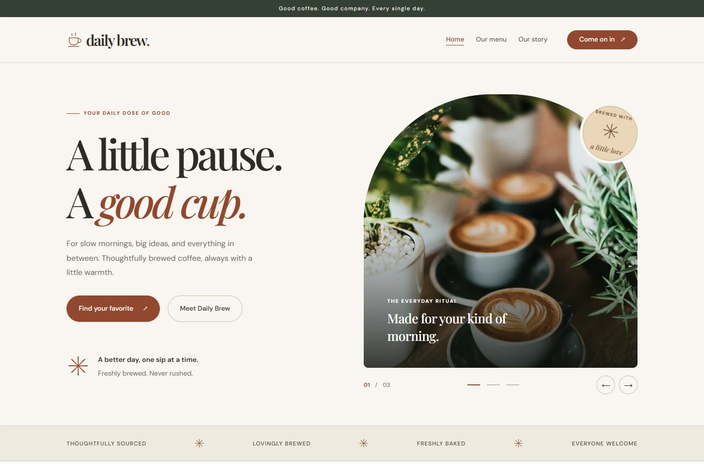

# Daily Brew

A responsive café website for the **WEB Technologies 1 Bootstrap midterm**. Warm colors, local photography, editorial typography, and a small set of useful interactions — built with HTML, CSS, Bootstrap 5.3.3, and vanilla JavaScript.



## Run locally

Open `index.html` in a modern browser. No installation, build step, account, or internet connection is needed: Bootstrap, fonts, and images are included.

Alternatively, serve the folder with Python:

```sh
python -m http.server 8000
```

Then open [localhost:8000](http://localhost:8000).

## Features

- A three-photo Bootstrap carousel with previous/next buttons, indicators, a live counter, and arrow-key navigation when focused. It does not autoplay.
- A menu with **All favorites**, **Coffee**, and **Bakery** filters.
- Bootstrap product dialogs with descriptions, ingredients, prices, and dietary notes. Escape closes a dialog and returns focus to its trigger.
- A sticky navigation bar that collapses on mobile, closes after selecting a link, and highlights the current section.
- Responsive layouts, descriptive image alternatives, a skip link, visible keyboard focus, and reduced-motion support.
- Local WebP images and WOFF2 fonts; the page makes no external requests.

## Assignment coverage

| Requirement                 | Implementation                                                                                                                                                                                                           |
| --------------------------- | ------------------------------------------------------------------------------------------------------------------------------------------------------------------------------------------------------------------------ |
| Two-column Bootstrap grid   | Hero and story sections use `row`, `col-sm-12`, and `col-lg-6`.                                                                                                                                                          |
| Three-column Bootstrap grid | Menu cards use `col-sm-12 col-md-6 col-lg-4`: one column on phones, two on tablets, three on desktop.                                                                                                                    |
| Containers                  | Each section uses a Bootstrap `container` for consistent alignment.                                                                                                                                                      |
| Spacing utilities           | Layout margins and padding use Bootstrap `m-*`, `p-*`, `g-*`, and `gap-*` utilities, including responsive variants such as `py-lg-4` and `ps-lg-5`. Custom CSS handles colors, typography, image sizing, and decoration. |
| Responsive navbar           | Bootstrap `navbar`, four section links, and a working `navbar-toggler` / `collapse`.                                                                                                                                     |
| Button variants             | `btn-primary`, `btn-outline-dark`, `btn-light`, `btn-lg`, and `btn-sm`.                                                                                                                                                  |
| Optional button group       | Menu filters use `btn-group` and communicate selection with `aria-pressed`.                                                                                                                                              |
| Carousel                    | Three images, indicators, previous/next controls, and keyboard navigation inside the hero grid.                                                                                                                          |
| Cards                       | Three Bootstrap `card` elements, each with an image, title, description, and price, arranged in a responsive `row card-group`.                                                                                           |
| Accessibility               | Semantic landmarks, heading hierarchy, labeled controls, image alternatives, checked contrast, focus handling, and reduced-motion support.                                                                               |

The optional form is not included; this project has no backend or reservation service.

## Project structure

```text
index.html             Page structure and Bootstrap components
style.css              Brand styles, typography, and responsive image sizes
script.js              Filtering, dialog content, carousel state, and navigation
assets/fonts/          Local fonts and their licenses
assets/images/         Optimized photographs and the SVG favicon
assets/vendor/         Bootstrap CSS and bundled JavaScript
assets/ATTRIBUTION.md  Image, font, and framework credits
docs/preview.webp      Desktop preview
```

## Validation

Checked in Chrome using Playwright:

- Layouts at 320, 375, 390, 575, 576, 768, 991, 992, 1024, 1280, 1440, and 1920 px, with no horizontal overflow and the expected column counts.
- All menu filters, all three product dialogs, Escape and focus restoration, carousel wrapping and indicators, keyboard carousel controls, and mobile navigation.
- No JavaScript errors, missing assets, or external network requests.
- Direct `file://` opening with networking disabled; core content also remains readable when JavaScript is disabled.
- Axe-core 4.10.3 checks for WCAG A/AA rules on desktop, mobile, and a product dialog: no violations reported. Automated checks do not replace a full accessibility review.
- JavaScript syntax and Git whitespace checks.

To check manually, resize the page, try each menu filter, open a product, close it with Escape, use the carousel controls, and open the hamburger menu on a phone-sized viewport.

The café, menu, prices, ingredients, and opening hours are demonstration content. Asset sources and licenses are listed in [assets/ATTRIBUTION.md](assets/ATTRIBUTION.md).
